# 03 · สถาปัตยกรรมโค้ด (Architecture)

## ไฟล์ในโปรเจกต์

```
OBD_Dashboard/
├── OBD_Dashboard.ino   จุดเริ่ม: setup/loop, หน้าเพจ, งาน OBD บนคอร์ 0, โหมด demo
├── board.h             ตั้งค่าจอ RGB (LovyanGFX) + ไดรเวอร์ touch GT911 แบบเขียนเอง
├── elm327_ble.h        คุยกับ ELM327 ผ่าน BLE: สแกน, หา UART service, ส่ง AT/OBD, อ่าน DTC
├── obd_pids.h          ตาราง PID mode 01 ~80 ตัว + สูตรถอดค่า + สีเตือน
├── dtc.h               ถอดรหัส DTC (mode 03/07), คำอธิบายโค้ดที่เจอบ่อย
├── ui.h                ธีม, แถบสถานะ, หน้า tach, หน้ากริดการ์ด, หน้า DTC
├── race.h              หน้า RACE + DIGITAL (+ ค้างค่าบูสต์สูงสุด)
├── alarms.h            เตือนต่ำ/สูงทุก PID, เกณฑ์เก็บใน NVS
├── trip.h              trip computer A/B (คำนวณ + หน้าจอ), เก็บใน NVS
├── launch.h            จับเวลา 0–100 / 100–0 (คำนวณ + หน้าจอ)
├── health.h            หน้า HEALTH: สรุปต่อทริป, baseline, เขียว/เหลือง/แดง (เก็บ NVS)
├── moto.h              หน้า SCOOTER + BLUE LCD สไตล์หน้าปัดมอเตอร์ไซค์ (ตัวเลข 7-segment วาดเอง)
├── nav.h               หน้า NAV: รับคำแนะนำเลี้ยวจากมือถือทาง BLE (GATT server) + ลูกศร/ระยะ/ถนน
└── cluster.h           หน้าปัดเข็ม — ถอดออกจากรอบหน้าแล้ว (ไม่ได้ include) เก็บไว้เผื่อนำกลับมา
ESP32_4827S043_Test/    เฟิร์มแวร์ทดสอบฮาร์ดแวร์แยกต่างหาก
```

ทุกไฟล์เป็น header-only (`static` / inline) คอมไพล์รวมเป็น translation unit เดียว — ตั้งใจให้เปิดดูง่ายใน Arduino IDE

## สองคอร์ สองหน้าที่

```
┌──────────── Core 1: loop() — UI ────────────┐   ┌──────── Core 0: obdTask ────────┐
│ handleTouch()  → แตะ / กดค้าง                │   │ state machine การเชื่อมต่อ        │
│ simulate()     (เฉพาะโหมด demo)             │   │ Scan → Init → Ecu → Live         │
│ consumeSpeed() → trip + จับเวลา              │   │ pollLive(): อ่าน PID ของหน้าที่ │
│ render()       วาดเฉพาะส่วนที่เปลี่ยน       │   │   เปิดอยู่ทีละตัว + พื้นหลังทุก 1 วิ│
│ paceFrame()    ล็อก ~60 fps + นับ FPS       │   │   (speed + ค่าที่ตั้งเตือนไว้)    │
└───────────────────────┬─────────────────────┘   └───────────────┬──────────────────┘
                        │     ข้อมูลที่ใช้ร่วมกัน                    │
                        └──── pidValues[] (float, เขียน/อ่านแบบ atomic) ┘
                              statusMsg/statusDot, dtc, pollList, speedSample  ← ป้องกันด้วย mutex `lock`
                              flags volatile: demo, wantDisconnect, pagesDirty, dtcWanted, dtcBusy
```

**ทำไมต้องแยก:** คำสั่ง OBD หนึ่งคำสั่งใช้เวลา 50–200 ms (บางคำสั่งเช่น `0100` ตอน search protocol ใช้หลายวินาที)
ถ้ารันในลูปเดียวกับ UI จอจะค้างตามไปด้วย พอแยกแล้ว UI เดินที่ 60 fps ตลอด ค่าที่อ่านมาใหม่ก็แค่โผล่ในเฟรมถัดไป

**กฎ:**
- ห้ามเรียก `elm.*` จาก core 1 (UI) — ให้ตั้ง flag แล้วให้ `obdTask` ทำ (ดู `wantDisconnect`, `dtcWanted`)
- ห้ามวาดจอจาก core 0
- อ่าน/เขียน `String`, `std::vector`, `DtcReport` ข้ามคอร์ต้องถือ `Locked l;` เสมอ

## State machine การเชื่อมต่อ (`obdTask`)

| สถานะ | ทำอะไร | ไปต่อเมื่อ |
|---|---|---|
| `Scan` | สแกน BLE 5 วิ หา dongle ที่หน้าตาเหมือน OBD แล้ว connect | เชื่อมต่อ + เจอ notify/write characteristic → `Init` |
| `Init` | `ATZ ATE0 ATL0 ATS0 ATH0 ATAT1 ATSP0` | ELM ตอบ → `Ecu` |
| `Ecu` | ส่ง `0100` (รอได้ถึง 10 วิ) อ่าน bitmask PID ที่รถรองรับ, `ATDP`, `ATDPN` | ECU ตอบ → `Live` (ไม่ตอบ: ลองใหม่ทุก 3 วิ พร้อมโชว์แรงดันแบตจาก `ATRV`) |
| `Live` | วนอ่าน PID ของหน้าที่เปิดอยู่ | BLE หลุด → กลับ `Scan` |

## ระบบหน้า (pages)

| หน้า | ชนิด (`Dashboard::Kind`) | ไฟล์ | อ่าน PID อะไร |
|---|---|---|---|
| 0 | `RACE` สไตล์รถแข่ง (คาร์บอน, tach ไฟเป็นช่อง, shift light) | `race.h` | RPM + speed ทุกรอบ, วนอ่าน MAP / baro / ignition / intake / load / throttle / coolant / oil / battery / fuel |
| 1 | `DIGITAL` ตัวเลขสีส้มแบบ OLED | `race.h` | RPM ทุกรอบ, วนอ่าน MAP / baro / coolant / lambda / battery |
| 2 | `GAUGE` tach + 6 การ์ด | `ui.h` | RPM + speed ทุกรอบ, วนอ่าน 6 ค่าหลัก |
| 3 | `TRIP` trip A / B | `trip.h` | RPM + speed ทุกรอบ |
| 4 | `TIMER` 0–100 / 100–0 | `launch.h` | ปกติ RPM + speed; กด ARM แล้ว **อ่านแค่ `010D`** (ไม่มีงานพื้นหลัง) |
| 5 | `SCOOTER` จอ LCD สกู๊ตเตอร์ไฟฟ้า (ฟ้าอมเขียว แถบความเร็วขั้นบันได) | `moto.h` | RPM + speed ทุกรอบ, วนอ่าน coolant / battery / fuel |
| 6 | `BLUE_LCD` จอ LCD น้ำเงินสไตล์สกู๊ตเตอร์ 160cc | `moto.h` | RPM + speed ทุกรอบ, วนอ่าน MAF (ถี่เป็นสองเท่า) / fuel rate / coolant / battery / fuel / run time / oil |
| 7 | `NAV` นำทางจากมือถือ (ลูกศร ระยะ ถนน ETA) | `nav.h` | RPM + speed ทุกรอบ (speed ใช้นับระยะถอยหลัง) |
| 8 … n-3 | `GRID` 8 การ์ด/หน้า | `ui.h` | วนอ่าน 8 ค่าในหน้านั้น |
| n-2 | `HEALTH` สัญญาณเตือนล่วงหน้า | `health.h` | แบต / น้ำ / LTFT 1-2 / O2 หน้า-หลัง / RPM |
| n-1 | `DTC` | `ui.h` | `0101` + `03` + `07` ตอนเข้าหน้า และตอนกด RESCAN |

ค่าที่คำนวณเพิ่ม (ใน `render()`):
- **บูสต์ (bar)** = (MAP − baro) / 100 — ถ้าไม่มี baro ใช้ 101.3 kPa
- **AFR** = lambda (PID 24 ถ้ามี ไม่งั้น 44) × 14.7 (ค่าของเบนซิน — ดีเซลจะไม่แม่น)

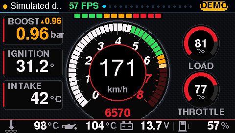 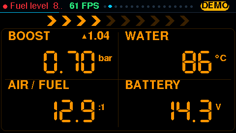
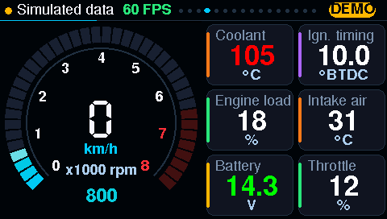 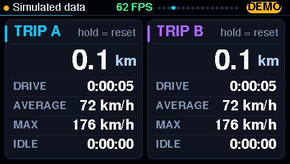
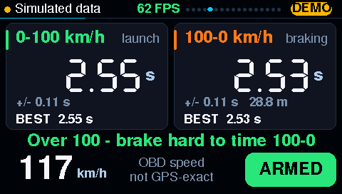 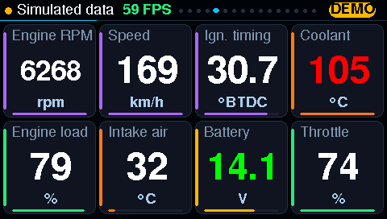
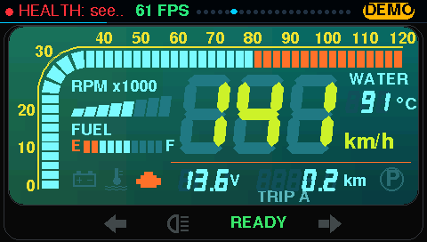 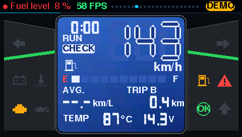
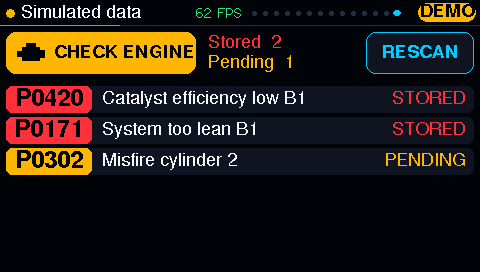 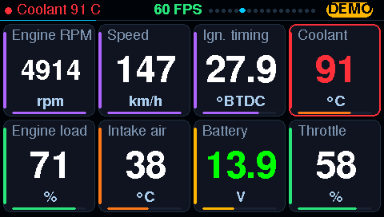

- หน้า GRID สร้างอัตโนมัติจาก PID ที่ **รถคันนั้นรองรับจริง** (`buildPages()` หลังเข้า `Live`)
- ระหว่างยังไม่ต่อรถ / โหมด demo จะโชว์ทุก PID
- **อ่านเฉพาะค่าที่อยู่บนจอ** → ค่าที่เห็นอัปเดตเร็วขึ้น (ไม่เสียเวลาอ่านค่าที่มองไม่เห็น)
  ยกเว้น "งานพื้นหลัง" ทุก ~1 วิ: speed (ให้ trip นับต่อทุกหน้า) + ค่าที่ตั้งเตือนไว้ทีละตัว (ให้เตือนได้ทุกหน้า)

การแตะ (ทำงานตอน **ปล่อยนิ้ว** เพื่อแยกจากการกดค้าง):
- แตะขวา/กลาง = หน้าถัดไป, แตะขอบซ้าย (x < 120) = ย้อนกลับ, ปุ่ม DEMO มุมขวาบน, ปุ่ม RESCAN (DTC), ปุ่ม ARM (TIMER)
- **กดค้าง 0.7 วิ** = รีเซ็ตสิ่งที่อยู่ใต้นิ้ว: ช่อง BOOST (RACE/DIGITAL) → ค่าบูสต์สูงสุด, แผง TRIP A/B → ทริปนั้น, แผงผลจับเวลา → ล้างผล

## ค้างค่าบูสต์สูงสุด (peak hold)

`boostPeak` ใน `.ino` = ค่าบูสต์สูงสุดตั้งแต่รีเซ็ต (ไม่ต่ำกว่า 0.00) โชว์เป็นตัวเลขสีอำพันมี ▲ นำหน้า
มุมขวาบนของช่อง BOOST ทั้งหน้า RACE และ DIGITAL — ไม่เก็บลง NVS (รีเซ็ตตอนเปิดเครื่อง/สลับ demo)

## เตือนต่ำ/สูง (`alarms.h`)

- เกณฑ์ต่อ PID `{lo, hi}` (NAN = ไม่เตือนฝั่งนั้น) ค่าเริ่มต้น: น้ำ > 105 °C, น้ำมันเครื่อง > 130 °C, แบต < 12.0 V หรือ > 15.0 V, น้ำมัน < 15 %
- เก็บใน NVS namespace `alarms` คีย์ `p<PID>` — PID ที่ไม่มีคีย์ใช้ค่าเริ่มต้น
- **hysteresis ตามเวลา:** ต้องเกินต่อเนื่อง 1 วิถึงจะเตือน และต้องกลับเข้าช่วง 1 วิถึงจะเลิก → ค่าที่แกว่งรอบเกณฑ์ไม่ทำให้การ์ดกระพริบมั่ว
- เตือนแล้ว: การ์ด/ตัวเลขกระพริบแดง 2 Hz (ทุกหน้าใช้จังหวะเดียวกัน) + แถบสถานะด้านบนขึ้นชื่อค่าเป็นสีแดงไม่ว่าอยู่หน้าไหน
- ยังไม่มีหน้าตั้งค่าบนจอ — ตั้งผ่าน serial (ด้านล่าง) ไว้ทำร่วมกับหน้าตั้งค่า Wi-Fi ในอนาคต; ยังไม่มีบัซเซอร์ (ไม่มีบนบอร์ด)

## Trip computer (`trip.h`)

- ทริป A และ B นับพร้อมกันจากทุกค่าความเร็ว (รีเซ็ตแยกกัน) — ใช้ A = วันนี้, B = ตั้งแต่เติมน้ำมัน
- ระยะทาง = อินทิเกรตความเร็วแบบสี่เหลี่ยมคางหมูระหว่างสองค่า (`double` กันทศนิยมหายตอนวิ่งไกล)
  ช่วงที่ขาดเกิน 3 วิ (หลุด/อ่านไม่ทัน) **ข้าม** ไม่เดา
- DRIVE = เวลาที่รถเคลื่อนที่, IDLE = จอดแต่เครื่องติด (RPM > 300 หรือไม่รู้ RPM แต่ ECU ยังตอบ), AVERAGE = ระยะ / เวลา DRIVE
- เก็บ NVS namespace `trip` ทุก 30 วิที่มีการเปลี่ยนแปลง + ตอนอ่านความเร็วไม่ได้ (ดับเครื่อง) → ไฟดับกะทันหันเสียไม่เกิน 30 วิ
- โหมด demo ใช้ทริปแยก (`demoTrip`) ไม่บันทึก → ไม่ปนกับทริปจริง

## จับเวลา 0–100 / 100–0 (`launch.h`)

- กด ARM → อ่านแค่ PID `0D` (เร็วสุดที่ adapter ทำได้ ~5–15 Hz) จนกด ARM อีกครั้ง
- 0–100: ต้องหยุดนิ่งก่อน (READY) เริ่ม = กึ่งกลางระหว่างค่า 0 สุดท้ายกับค่าแรกที่ > 0, จบ = interpolate จุดตัด 100
- 100–0: วิ่งเกิน 100 ก่อน, เริ่ม = interpolate จุดตัด 100 ลง, จบ = กึ่งกลางระหว่างค่าสุดท้ายที่ > 0 กับ 0 + ระยะเบรก (m)
- ยกเลิกถ้า: ข้อมูลขาด > 1.5 วิ, 0–100 เกิน 30 วิ, 100–0 เกิน 20 วิ หรือเร่งกลับ > 5 km/h
- **+/-** ที่โชว์ = ครึ่งของช่วงห่างระหว่างค่าที่ปลายทั้งสองรวมกัน (กรณีแย่สุด) — ความเร็ว OBD เป็นจำนวนเต็มและ ECU กรองสัญญาณ จึงไม่แม่นเท่า GPS
- เก็บผลล่าสุด + ดีที่สุดใน RAM (ไม่ลง NVS)

## HEALTH — เตือนล่วงหน้า (`health.h`)

ใช้แค่ข้อมูลมาตรฐาน mode 01 (+ DTC ที่อ่านอยู่แล้ว) เป็น **สัญญาณบอกแนวโน้ม ไม่ใช่การทำนายวันพัง** — บนจอเขียนไว้ชัด

| แถว | วัดอะไร (ต่อทริป) | เหลือง (CHECK) | แดง (FAULT) |
|---|---|---|---|
| CHARGING | ค่าเฉลี่ย `0142`/`ATRV` ตอน RPM > 500 หลังสตาร์ต 30 วิ (ค่าเฉลี่ยทั้งทริป ไม่ใช่ค่าต่ำสุด — smart alternator ตัดไฟชั่วคราวได้) | < 13.2 / > 14.8 V หรือต่ำกว่า baseline ≥ 0.3 V | < 12.8 / > 15.0 V |
| FUEL TRIM | ค่าเฉลี่ย LTFT (`0107`/`0109` เอา bank ที่แย่กว่า) ตอนน้ำ > 75 °C | \|LTFT\| > 10 % หรือขยับจาก baseline ≥ 5 % | > 20 % |
| THERMOSTAT | เวลาจากสตาร์ตเย็น (น้ำ < 50 °C) ถึง 80 °C; สตาร์ตตอนอุ่นไม่นับ | > 15 นาที หรือช้ากว่า baseline ≥ 50 % | ติดเครื่อง > 20 นาทีน้ำยัง < 75 °C (วาล์วค้างเปิด — โชว์ทันทีระหว่างขับ) |
| CATALYST | ช่วง 30 วิที่ขับนิ่ง (น้ำ > 75 °C, 1200–3500 rpm) และ O2 หน้า (`0114`) สวิง > 0.4 V: อัตราส่วน สวิง O2 หลัง (`0115`) / สวิง O2 หน้า | ≥ 50 % หรือเพิ่มจาก baseline ≥ 20 จุด | ≥ 80 % |
| TROUBLE CODES | ผลอ่าน DTC ล่าสุด | มี pending | มี stored หรือไฟเช็คเอนจิ้นติด |

- **ทริป** = ECU ตอบ + RPM > 300 จน RPM หาย/< 300 เกิน 10 วิ; ต้องติดเครื่อง ≥ 5 นาทีถึงบันทึก
- สรุปทริปละ 12 ไบต์ เก็บ 32 ทริปล่าสุดเป็น ring ใน NVS namespace `health` (blob เดียว ~460 ไบต์ **เขียนครั้งเดียวตอนจบทริป** → ไม่ทำให้ flash สึก)
- **baseline** = มัธยฐานของ 8 ค่าแรกที่วัดได้ของแต่ละหัวข้อ ล็อกไว้ — **กดค้างบนหน้า HEALTH** (หรือ serial `R`) = เรียนรู้ใหม่จากทริปล่าสุด (ใช้หลังเปลี่ยนอะไหล่)
  ก่อนครบ 8 ค่า แถวที่ผ่านเกณฑ์ตายตัวจะเป็นสีฟ้า `LEARNING n/8`
- ค่าที่โชว์ = มัธยฐานของ 3 ค่าล่าสุด (ทริปที่กำลังขับ ถ้ามีข้อมูลพอ + ทริปที่บันทึกไว้) → ทริปเดียวที่แปลก ๆ ไม่ทำให้เปลี่ยนสี
- CATALYST ใช้ได้เฉพาะรถที่ O2 หน้าเป็นแบบสวิง (narrowband); รถที่ใช้ wideband (`0124`/`0134`) ขึ้น N/A
- งานพื้นหลังเพิ่ม 1 PID ทุก 0.4 วิ (O2 หน้า/หลังได้ทุกช่องเว้นช่อง, ที่เหลือ แบต/น้ำ/LTFT/RPM สลับกัน) — หน้า RACE ช้าลงราว 2 PID/วิ
- จบ/เริ่มทริปแล้วมีแถวเหลืองหรือแดง → แถบสถานะขึ้น `HEALTH: see page` 20 วิ ครั้งเดียว (ไม่กระพริบ, alarm ต่ำ/สูงสำคัญกว่า)
- โหมด demo ใช้ประวัติจำลอง (`seedDemo()`: baseline ปกติ แล้วไดชาร์จอ่อน, LTFT บาง, วาล์วน้ำช้า) ไม่บันทึกลง NVS

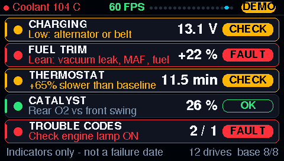

## นำทางจากมือถือ (`nav.h`)

เกจเป็น **BLE client** ของ ELM327 และเป็น **GATT server** ให้มือถือในเวลาเดียวกัน
(core 3.3.10 ใช้ NimBLE รองรับ 3 การเชื่อมต่อ — เหตุผลและที่มาใน [09-roadmap.md](09-roadmap.md) หัวข้อ "นำทาง Google Maps")

| ส่วน | รายละเอียด |
|---|---|
| service | `5a4e0001-8f6b-4c1e-9a43-6d0c5e7a1b20` advertise ชื่อเดียวกับ BLE (`OBD-Dash`) |
| NAV `5a4e0002-…` (write) | ข้อความ UTF-8 `N\|<turn>\|<เมตร>\|<eta>\|<ถนน>` หรือ `X` = จบนำทาง |
| ICON `5a4e0003-…` (write no response) | ไอคอน 48×48 1-bit (288 ไบต์ แถวละ 6 ไบต์ MSB ก่อน) ส่งเป็นท่อน `[offset lo][offset hi][ข้อมูล…]` ใช้เมื่อ turn = `icon` |

- `<turn>`: `straight left right slight-left slight-right sharp-left sharp-right uturn roundabout arrive icon`
  เว้นว่าง = เดาจากข้อความใน `<ถนน>` เช่น "Turn left onto Rama 4" → ลูกศรซ้าย + ถนน "Rama 4" (ทางสำหรับ iPhone/ANCS ที่ได้แค่ข้อความ)
- callback ของ BLE (task ของ NimBLE) แค่คัดลอกลง `nav::g` ใต้ spinlock — วาดจอบน core 1 เท่านั้น ตามกฎข้างบน
- ระหว่างที่มือถือยังไม่ส่งค่าใหม่ ระยะที่โชว์ = ค่าจากมือถือ − ระยะที่วิ่งไปตามความเร็ว OBD (`nav::Tracker`)
- ไม่มีข้อมูลใหม่ 30 วิ = ถือว่าเลิกนำทาง; มือถือหลุด → advertise ใหม่เอง
- ทุกหน้าอื่น: ถ้าเหลือ ≤ 1 กม. ถึงจุดเลี้ยว แถบสถานะขึ้น `LEFT in 300 m` สีฟ้า (alarm ต่ำ/สูงสำคัญกว่า, ทางตรงไม่ขึ้น)
- ไม่มีฟอนต์ไทย: ตัวอักษรที่ไม่ใช่ ASCII ถูกตัดทิ้ง
- **RAM ภายใน:** `setup()` จอง `BLE_HEAP_RESERVE` (32 KB) ไว้ระหว่างที่ทุกหน้าสร้าง sprite แล้วคืน — ไม่งั้น sprite กิน RAM ภายในจนการเชื่อมต่อที่สองล้ม
  (`BLE_INIT: Malloc failed`) หน้าใหม่ที่ `begin()` ทีหลังอาจได้ sprite ใน PSRAM แทน; serial `H` บอก heap ที่เหลือ
- callback ของ BLE ห้าม `Serial.print` — task ของ NimBLE ไม่ถูกพักตอนถ่ายภาพหน้าจอ ข้อความจะแทรกกลาง pixel stream
- ใครอยู่ใกล้ ๆ ก็เขียนข้อความขึ้นจอได้ (ยังไม่มี pairing) — ข้อมูลแค่โชว์ ไม่ควบคุมอะไร
- โหมด demo: เส้นทางจำลองในกรุงเทพฯ (ถ้ามือถือส่งมาจริงภายใน 10 วิ ใช้ของมือถือแทน)
- ทดสอบจาก PC ที่มีบลูทูธ: `pip install bleak` แล้ว `python tools/nav_send.py` (ดูตัวเลือกในหัวไฟล์)

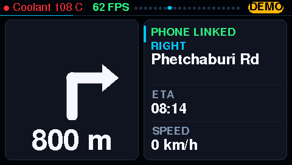

## คำสั่ง serial (115200)

| คำสั่ง | ทำอะไร |
|---|---|
| `S` | ภาพหน้าจอ (ใช้กับ `tools/screenshot.py`) |
| `D` / `N` / `P` | demo / หน้าถัดไป / ก่อนหน้า |
| `R` / `B` | รีเซ็ต (เหมือนกดค้าง): บูสต์สูงสุด / trip A / ผลจับเวลา / baseline HEALTH — `B` = trip B |
| `A` | ARM/ปลด การจับเวลา (เฉพาะหน้า TIMER) |
| `L` | แสดงเกณฑ์เตือนทั้งหมด |
| `L05 - 110` | ตั้ง coolant: ไม่มีขั้นต่ำ, สูงสุด 110 (PID เป็นเลขฐาน 16, `-` = ไม่เตือน) |
| `L!` | กลับค่าเริ่มต้น |
| `VN\|left\|300\|14:32\|Rama IV Rd` | ป้อนคำแนะนำนำทางเหมือนมือถือส่งมา (`VX` = จบ) |
| `H` | heap ภายในที่เหลือ (ต่ำสุด / ก้อนใหญ่สุด), PSRAM, สถานะมือถือ |

## โหมด DEMO

`simulate()` สร้างค่าปลอมจากช่วง `lo..hi` ในตาราง PID + คลื่น sine และ DTC ตัวอย่าง (P0420, P0171, P0302)
หน้า HEALTH ใช้ประวัติทริปจำลองที่โชว์ครบทั้งเขียว เหลือง แดง
ใช้ทดสอบ UI ได้โดยไม่ต้องมีรถหรือ dongle ตอนเปิด demo งาน OBD จะตัดการเชื่อมต่อและพักไว้

## จะเพิ่มหน้าใหม่ต้องแก้ตรงไหน

1. เพิ่มค่าใน `enum Kind` ใน [`ui.h`](../OBD_Dashboard/ui.h)
2. `showPage()` / `pageCount()` ใน `.ino` — กำหนดตำแหน่งหน้าและ `setPoll(...)` ว่าหน้านี้ต้องอ่าน PID อะไร
3. `render()` — เรียกฟังก์ชันวาดของหน้านั้น
4. ถ้ามี "ปุ่ม" หรือ "กดค้าง" ในหน้า: เพิ่มใน `onTap()` / `onLongPress()`
5. วาดแบบ "เฉพาะส่วนที่เปลี่ยน" ตาม [07-ui-and-performance.md](07-ui-and-performance.md) ไม่งั้น FPS จะตก
